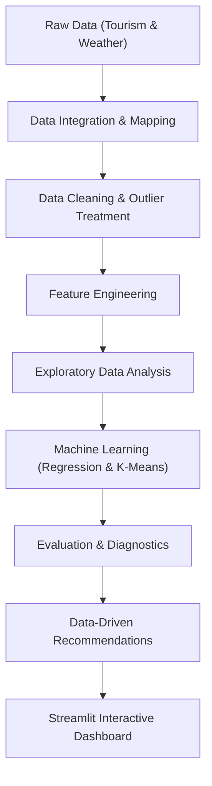

# Tourist Demand Pattern Analysis Across Indian Destinations

**Course:** DS2004: Fundamentals of Data Science  
**Academic Level:** College Course Project  
**Tech Stack:** Python, Pandas, NumPy, Scikit-learn, Plotly, Seaborn, Matplotlib, Streamlit, Folium  

---

## 1. Executive Summary & Problem Definition

Tourism in India is one of the largest services industries and a primary driver of employment, regional GDP, and foreign exchange earnings. However, the Indian tourism landscape suffers from two systemic vulnerabilities:
1. **Extreme Spatial Over-Concentration:** Footfalls are concentrated in a tiny fraction of cultural landmarks (e.g., the top 5 monuments capture ~30% of all recorded ASI footfall, led by the Taj Mahal with over 5 million annual visits), leaving secondary and regional cultural circuits under-utilized.
2. **Sharp Temporal & Seasonal Volatility:** Inbound international tourism peaks dramatically during Post-Monsoon (Q4: Oct–Dec, ~30.5%) and Winter (Q1: Jan–Mar, ~28.8%), creating severe carrying capacity strains, local transit gridlocks, and monument degradation, followed by severe slumps during the summer months (Q2: Apr–Jun, ~19.1%).

### Real-World Decision Context
State Tourism Boards, the Archaeological Survey of India (ASI), municipal transit authorities, and private hospitality operators require empirical data science models to:
- Dynamically schedule staffing, ticket pricing, and visitor flow control.
- Identify climate-sensitive destinations prone to heat stress or torrential monsoon disruptions.
- Decongest mega-hubs by directing tourists to adjacent satellite heritage sites.
- Predict future destination demand given infrastructural and climatic parameters.
- Target customized marketing strategies toward specific destination behavior clusters.

---

## 2. Authentic Data Sources Used

This project strictly adheres to real-world empirical data without simulated or fabricated statistics:

| Data Source | Provider | Scope & Granularity | Key Metrics |
| :--- | :--- | :--- | :--- |
| **ASI Ticketed Monuments Footfall** | Ministry of Tourism, Govt of India | 178 records across 34 Circles (2019–2021) | Domestic visits, Foreign visits, Annual growth rates |
| **State/UT Tourism Statistics** | Ministry of Tourism, Govt of India | All 36 States & UTs (2019–2020) | Domestic visits (DTV), Foreign visits (FTV), State growth rates |
| **Quarterly Seasonal Arrivals** | Ministry of Tourism, Govt of India | 19-Year Longitudinal Series (2001–2019) | Quarterly percentage distribution (Q1, Q2, Q3, Q4) |
| **Longitudinal FTA Time Series** | Ministry of Tourism, Govt of India | 40-Year Macro Series (1981–2020) | Annual FTAs (Millions), NRIs, ITAs, YoY growth |
| **Historical Weather Archive** | Open-Meteo Historical Archive (ERA5) | 33 Destination Coordinates across India | Annual/Seasonal mean temperature, total rainfall, min/max temp |

---

## 3. Project Directory Structure

```text
├── data/
│   ├── raw/                              # Authentic raw CSVs from official sources
│   │   ├── India-Tourism-Statistics-2021-monuments.csv
│   │   ├── India-Tourism-Statistics-statewise_2019-2020_domestic_foreign.csv
│   │   ├── India-Tourism-Statistics-2001-2019-quaterly.csv
│   │   ├── India-Tourism-Statistics-1981-2020-fta_nri_ita.csv
│   │   └── india_weather_historical.csv  # Queried from Open-Meteo Archive
│   └── processed/                        # Cleaned & feature-engineered datasets
│       ├── destinations_cleaned.csv
│       ├── destinations_featured.csv
│       ├── destinations_clustered.csv
│       ├── statewise_tourism_cleaned.csv
│       ├── seasonal_quarterly_cleaned.csv
│       └── longitudinal_fta_cleaned.csv
├── src/                                  # Core modular python source code
│   ├── __init__.py
│   ├── data_loader.py                   # Data ingestion module
│   ├── cleaner.py                       # Cleaning, standardization, outlier treatment
│   ├── feature_engineering.py           # Domain feature extraction
│   ├── eda.py                           # Publication static & interactive plots
│   ├── models.py                        # Supervised Linear Regression pipeline
│   ├── clustering.py                    # Unsupervised K-Means clustering pipeline
│   └── recommender.py                   # Dynamic data-driven recommendation engine
├── models/                               # Serialized model artifacts (.joblib)
│   ├── linear_regression_model.joblib
│   └── kmeans_clustering_model.joblib
├── outputs/                              # Exported artifacts and deliverables
│   ├── figures/                         # High-res static PNG figures for reports
│   └── tables/                          # CSV audit tables (metrics, outliers, coefs)
├── notebooks/                            # End-to-end reproducible analysis
│   └── tourist_demand_analysis.ipynb
├── app.py                                # 9-page interactive Streamlit dashboard
├── requirements.txt                      # Project dependencies
└── README.md                             # Comprehensive project documentation
```

---

## 4. End-to-End Data Pipeline



### Data Cleaning & Outlier Treatment Highlights:
1. **Subtotal Elimination:** The raw ASI monument dataset contains 34 circle `Total` and national `Grand Total` rows. If not filtered out, all footfall totals are doubled. Our cleaning pipeline filters these aggregate rows, leaving exactly **144 individual monuments**.
2. **State Standardization:** Standardized discrepancies such as `Telengana` $\rightarrow$ `Telangana`, `A&N Island` $\rightarrow$ `Andaman & Nicobar Islands`, and `J&K` $\rightarrow$ `Jammu & Kashmir`.
3. **Outlier Detection:** Computed IQR upper bound ($Q_3 + 1.5 \times IQR = 787,986$). Identified 14 statistical upper outliers (Taj Mahal, Qutub Minar, Red Fort, Agra Fort, Sun Temple Konark, Golconda Fort, etc.).
4. **Principled Treatment:** Real-world heritage icons are valid high-traffic destinations, not measurement errors. To preserve real numbers for business reporting while satisfying Gauss-Markov linear model assumptions, we retained actual counts for display while generating a logarithmic transformation $y = \ln(1 + \text{Visits})$ and 95th-percentile Winsorization for model training.

---

## 5. Domain Feature Engineering

- **Visitor Share Metrics:** `Domestic_Tourist_Share`, `Foreign_Tourist_Share`, `Domestic_to_Foreign_Ratio`.
- **Thermal Comfort Deviation:** $| \text{Annual\_Avg\_Temp\_C} - 22.0^\circ\text{C} |$ (measuring deviation from optimal human thermal comfort).
- **Rainfall Exposure:** `Monsoon_Rainfall_Share`, `Rainfall_Severity_Category` (Arid, Moderate, Heavy, Coastal Monsoon).
- **UNESCO Recognition:** Binary flag indicating international UNESCO World Heritage status.
- **Architectural & Cultural Typology:** Categorized into 6 architectural structural classes: `Fort & Palace`, `Temple & Religious`, `Caves & Rock-Cut`, `Mausoleum & Tomb`, `Archaeological Ruins`, `Heritage & Memorial`.
- **Logarithmic Transforms:** $\ln(1 + \text{Visits})$ for variance stabilization.

---

## 6. Machine Learning Models & Evaluation

### Supervised Learning: Multiple Linear Regression
- **Target:** $\ln(1 + \text{Total Tourist Visits})$ (with inverse exponential back-transformation to actual visitor counts).
- **Features:** UNESCO status, Foreign tourist share, Domestic tourist share, Temperature deviation from 22°C, Annual precipitation, Monsoon rainfall, Destination structural typologies.
- **Evaluation Benchmarks (20% Holdout Test Set):**
  - **Log-Scale MAE:** `1.343`
  - **Log-Scale RMSE:** `1.783`
  - **Log-Scale $R^2$:** `0.106`
  - **5-Fold Cross Validation $R^2$:** `0.090 ± 0.089`
  - **5-Fold Cross Validation MAE:** `1.204`
  - **Actual Visitor Scale MAE:** `295,258 visits`
- **Key Feature Coefficients:**
  - $\text{Is\_UNESCO\_Site}$ ($+0.696$): Significant positive demand driver.
  - $\text{Type\_Fort\_\&\_Palace}$ ($+0.472$): Strong structural attraction.
  - $\text{Temp\_Ideal\_Deviation}$ ($-0.299$): Negative penalty for thermal discomfort.
  - $\text{Foreign\_Tourist\_Share}$ ($+0.187$): Positive international profile correlation.

### Unsupervised Learning: K-Means Destination Clustering
- **Features Used:** Log visits, Foreign tourist share, Domestic growth rate, Average temperature, Annual rainfall, Thermal deviation.
- **Model Validation:** Evaluated $k \in [2, 8]$ using Inertia (Elbow Method) and Silhouette Analysis. Selected optimal **$k=4$** (Silhouette Score: **0.442**).
- **Discovered Cluster Archetypes:**
  1. **Cluster 0: Tier-1 Iconic Global Mega-Hubs (Red):** Very high volume (>1.5M), high international share (12-20%), UNESCO status (Taj Mahal, Agra Fort, Qutub Minar, Red Fort).
  2. **Cluster 1: Domestic Cultural Heritage Powerhouses (Blue):** Large domestic volume (>500k), overwhelmingly domestic (>97%), pilgrim and historical hubs (Sun Temple Konark, Golconda, Charminar).
  3. **Cluster 2: High-Precipitation & Monsoon-Sensitive Enclaves (Green):** Heavy annual rainfall (>2500 mm), strong seasonal variation, coastal & Western Ghats heritage (Goa, Kerala, Mumbai caves).
  4. **Cluster 3: Emerging & Niche Archaeological Sites (Orange):** Moderate/low volume (10k-100k), high development headroom, cultural ruins requiring promotional and infrastructural boosts.

---

## 7. Data-Driven Recommendations

All recommendations are calculated dynamically from data outputs:
1. **Seasonal Demand Surge Control (Q4 & Q1):** Q4 (Post-Monsoon, 30.5%) and Q1 (Winter, 28.8%) demand is **1.6x higher** than the summer trough. Enforce digital timed-entry passes and dynamic pricing during peak winter weekends.
2. **Summer Off-Season Stimulation (Q2):** Demand drops to 19.1% due to extreme North Indian heat (>38°C). Introduce discounted cultural passes, twilight/night tours, and indoor heritage museum incentives.
3. **Decongestion & Satellite Circuit Pairing:** The top 5 monuments account for **29.5% of total footfall**. Implement bundled circuit passes linking saturated hubs with nearby under-visited satellite sites (e.g., pairing Agra Fort and Taj Mahal with Fatehpur Sikri, Sikandra, and Mehtab Bagh).
4. **Climate Adaptation:** Provide misting stations, cold drinking water, and shaded corridors for monuments with average temperatures $>27.5^\circ\text{C}$; install moisture runoff and anti-slip safety pathways for coastal sites with $>2500$ mm rainfall.

---

## 8. Interactive Streamlit Dashboard

The application provides a 9-page dashboard:
1. **🏛️ Overview:** Project context, KPI metric cards, data health table, pipeline architecture.
2. **📈 Tourism Demand Analysis:** 40-year FTA longitudinal growth, state-wise rankings, domestic vs foreign visitor split.
3. **📍 Destination Analysis:** Top 15 monuments ranking, interactive Folium map of India, UNESCO vs non-UNESCO comparisons.
4. **🗓️ Seasonal Analysis:** 19-year quarterly distribution trends, seasonal doughnut chart, peak-to-trough ratio.
5. **🌦️ Weather & Tourism:** Temperature vs footfall regression, rainfall scatter, correlation matrix.
6. **🤖 ML Demand Prediction:** Multiple Linear Regression metrics, coefficient impact bars, real-time demand simulator with sliders.
7. **🎯 Destination Clustering:** K-Means PCA projection, Elbow curve & Silhouette score plots, cluster explorer.
8. **💡 Insights & Recommendations:** Data-driven policy roadmaps, decongestion imperatives, interactive destination recommender tool.
9. **ℹ️ Project Information:** DS2004 syllabus alignment, data sources audit trail, methodology documentation.

---

## 9. Setup and Execution Instructions

### Prerequisites
- Python 3.10+ (Tested on Python 3.14)
- Internet connection (for initial Open-Meteo weather fetch, if re-running data acquisition)

### Installation
```bash
# 1. Clone repository and navigate to workspace
cd "d:/Course project DT"

# 2. Install dependencies
python -m pip install -r requirements.txt
```

### Reproducing the Complete Pipeline
```bash
# 1. Clean raw data & detect outliers
python -m src.cleaner

# 2. Extract domain features
python -m src.feature_engineering

# 3. Generate static publication figures
python -m src.eda

# 4. Train and evaluate Linear Regression model
python -m src.models

# 5. Train and evaluate K-Means Clustering model
python -m src.clustering

# 6. Test recommendation engine
python -m src.recommender
```

### Launching the Dashboard
```bash
python -m streamlit run app.py
```
Open your web browser at `http://localhost:8501`.

---

## 10. Project Limitations & Future Extensions

1. **Granularity of Footfall Data:** The official ASI dataset records footfalls on an annual basis rather than daily or monthly. Incorporating automated turnstile IoT logs would enable high-resolution daily forecasting.
2. **Commercial & Hospitality Metrics:** Current analysis relies on ticketed heritage monument footfalls. Integrating real-time hotel average daily room rates (ADR) and airport passenger traffic would offer a broader economic picture.
3. **Exogenous Shocks:** While the dataset captures the 2020 pandemic downturn, future models can incorporate geopolitical and visa policy indices to model international demand elasticity.

---

**Course Project DS2004: Fundamentals of Data Science**  
*Completed for Academic Demonstration & Examination.*
